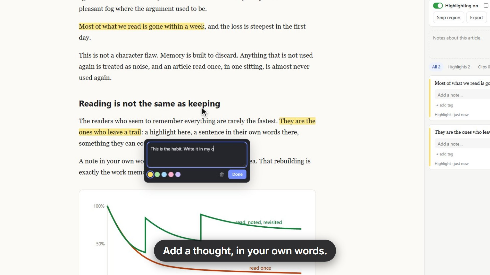

# Margin Notes

A Chrome/Edge extension for taking notes while you read: highlight passages, attach notes and tags, and clip passages or regions of the page as screenshots. Everything is stored locally in your browser (IndexedDB) and can be exported as Markdown or backed up as JSON.

[](docs/demo.mp4)

**[▶ Watch the 1-minute demo](docs/demo.mp4)** (made with the tooling in [demo-video/](demo-video/))

## Run it

```sh
npm install
npm run build
```

Then open `edge://extensions` (or `chrome://extensions`), turn on **Developer mode**, click **Load unpacked**, and pick `.output/chrome-mv3`.

For development with hot reload, run `npm run dev`. It launches the browser set in `web-ext.config.ts` (Edge on this machine) with the extension loaded.

## Using it

- **Turn it on:** click the toolbar icon. The side panel opens, and highlighting is enabled on that tab. You can also press `Alt+Shift+N`, or tick "Always on for this site" in the panel.
- **Highlight:** select text and a small toolbar appears. Pick a color, **Note** (highlight and type a note), **Clip** (save the passage as an image), or copy. Click an existing highlight to edit its note or color, or to delete it.
- **Snip:** press `Alt+Shift+S` or use **Snip region** in the panel, then drag a rectangle.
- **Right-click** a selection for Highlight, Highlight with note, and Clip.
- **Side panel:** shows this page's highlights and clips in reading order, plus a free-form page note. Click **Show** to scroll to a highlight; notes and tags can be edited inline.
- **Library** (button in the panel): every page you've annotated, with search, color and tag filters, Markdown/zip export, and JSON backup/import.

| Shortcut | Action |
| --- | --- |
| `Alt+Shift+P` | Open side panel |
| `Alt+Shift+N` | Toggle highlighting on this tab |
| `Alt+Shift+H` | Highlight current selection |
| `Alt+Shift+S` | Snip a region |

Change these at `edge://extensions/shortcuts`.

## Scripts

| Command | What it does |
| --- | --- |
| `npm run dev` | Dev build with hot reload, opens a browser |
| `npm run build` | Production build into `.output/chrome-mv3` |
| `npm test` | Unit tests (anchoring, capture planning, export, DB) |
| `npm run e2e` | Builds, loads the extension into headless Edge, and runs it end to end (selection toolbar, notes, reload restore, clips, snips, library). Screenshots land in `.output/e2e`. Set `BROWSER_PATH` to use another Chromium browser. |
| `npm run compile` | Type-check |
| `npm run zip` | Package for store upload |

## How it works

```
Web page (content script)        Service worker                    Extension pages
selection toolbar, popover  ──►  message router ──► IndexedDB ◄──  side panel, library
(closed shadow DOM)              captureVisibleTab                 (React + Dexie liveQuery)
<notes-mark> highlights     ◄──  notifies open tabs of changes
```

- **Anchoring** ([lib/anchoring.ts](lib/anchoring.ts)): a highlight is saved as its exact text, 32 characters of context on each side, and a position hint, all measured on whitespace-collapsed page text. On revisit, the extension finds the occurrence whose context matches best, so it survives layout changes and content inserted above it. Text that loads late is retried for 20 seconds. Highlights that can't be found are flagged in the side panel.
- **Storage** ([lib/db.ts](lib/db.ts)): only the service worker writes on behalf of content scripts, because a content script's IndexedDB belongs to the *website*, not the extension.
- **Screenshots** ([entrypoints/content/capture.ts](entrypoints/content/capture.ts)): `captureVisibleTab` is cropped to the region. Passages taller than the screen are scrolled, captured in slices (throttled to Chrome's limit of 2 per second) and stitched together. Sticky headers are hidden so they don't cover or repeat in the image.
- **Page identity** ([lib/url.ts](lib/url.ts)): URLs are normalized (no `#hash`, no `utm_*`/`fbclid` and similar), so the same article reached from different links shares its notes.

## Limitations

- Browsers don't allow extensions on built-in pages, the extension stores, or the built-in PDF viewer.
- Text inside iframes isn't highlightable.
- If a page's text changes substantially, some highlights may not re-anchor. They stay in the side panel and library with their quote.
